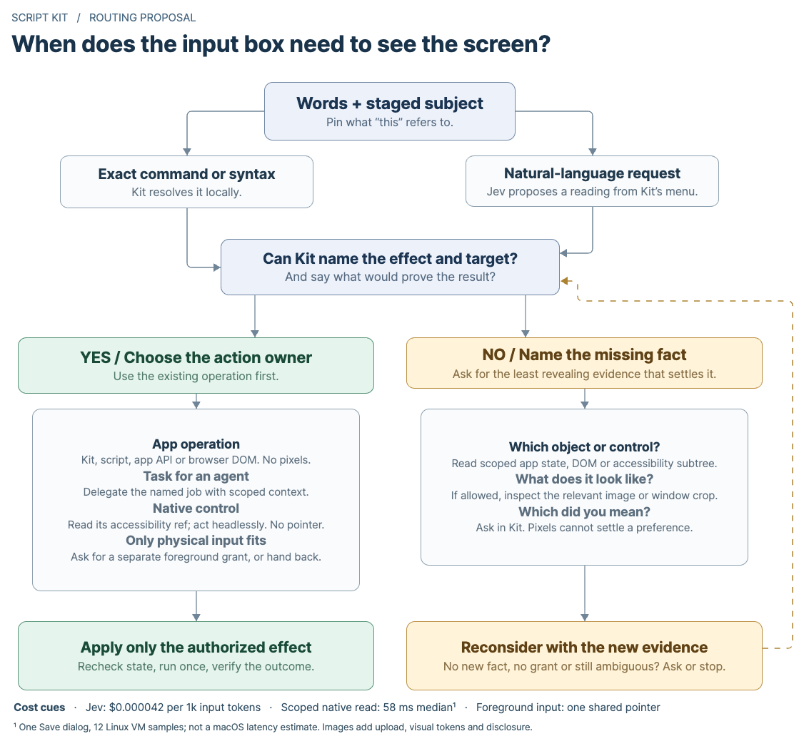

# From the input box to an action

**Proposed integration.** Let Jev decide which information would help. Let Kit decide what it is allowed to read or do. The distinction is between **choosing evidence** and **granting authority**, not between a smart route and a dumb one.

[Full-size flowchart](routing.png) · [Editable Eraser diagram](routing.json)

## What Jev should ask

Not *“How confident am I?”* but **“Which missing fact would change what we do, and where could we get it?”** Give Jev choices tied to the current request: `ready`, `read_app_state`, `inspect_controls`, `inspect_appearance`, `ask_person`, or `unsupported`. Its answer might amount to *“I know you want compact view; I don’t know which of these two unlabeled previews is compact.”* That is a reason to look. A low score by itself is not.

Kit checks the answer against the actual providers, the pinned app/window or staged artifact, and the caller’s grants. A model saying `ready` does not supply a missing target, an unsupported verb, or a permission. Don’t add a round trip just to ask this: include the evidence question in the existing text reading when useful. While someone types, work with the permitted context already in hand. Don’t walk an accessibility tree or capture a window on every keystroke. For a first version, budget one scoped lookup plus one narrower follow-up **only if it can distinguish the remaining choices**; otherwise offer the concrete choices in the same Kit window. Safety checks and result verification are separate from that exploration budget.

## Four sentences that take different routes

| From the input box | What happens | Why |
|---|---|---|
| “Add ‘check the microphone’ to today’s note.” | Jev reads the sentence; Kit uses its notes operation. An explicit note command can skip Jev. | The destination and write operation already exist. Opening an editor and typing is a worse way to do the same job. |
| “Name this export ‘Workshop outline’; don’t save.” | If there is no direct app operation, inspect just the originating sheet. Choose its visible writable filename field. Authorize **set value**, not **click**. Verify the field and that the sheet stayed open. | In the Linux fixture, filtering 54 refs left one eligible field; no screenshot or second model choice was needed. |
| “Which of these two layout previews is more compact?” | Use layout metadata if available. Otherwise inspect just the two staged images, or an allowed crop of the selected window; answer the question without clicking anything. | Appearance is the missing fact. A cropped image is evidence, not an input device. If the user later asks to apply it, map the chosen preview back to a current semantic target. |
| “Give this to the workshop agent.” | Resolve the staged subject and the live destination through its session interface. If two runs fit, ask which. Send only the chosen subject. | A screenshot of two terminals can’t tell us which colleague or run the user meant. Don’t type into whichever pane happens to have focus. |

## Cost and consequences

| Route | Incremental cost | What to watch |
|---|---|---|
| Kit operation, connected API or browser DOM | No Jev charge for a deterministic lookup or dispatch. A service or script can have its own costs. | Use IDs and structured results. Browser pages belong to their browser integration; native window chrome belongs to the desktop adapter. |
| Jev text decision | Direct TypeSafe list price: **$0.042 per million input tokens**, output free. At 1,000 input tokens, 10,000 readings cost **$0.42**. Each separate request adds a network round trip. | Send a short list and only the relevant state. A delegated agent job has its own latency, context and spending authority; Jev’s price is not the price of that job. |
| Headless `agent-desktop` | Local CLI; no inference required. One GTK Save dialog, 12 samples: **58 ms snapshot, 15 ms field read, 93 ms field write** (medians). | These are Linux guest timings, not a Mac SLA or a full launcher measurement. An accessibility tree can contain private text even when no pixels leave the machine. |
| Jev vision | Same input-token rate; capture, encoding, upload and inference add latency. Our synthetic rectangle request used **737 input tokens ≈ $0.000031**. This is one small test, not a screenshot tariff. | Prefer existing staged images to new captures. Permission to observe locally is not permission to send pixels to a provider. Box always returns a rectangle: ask about presence, and never treat a rectangle as click authority. |
| Human choice or physical input | Asking costs attention; foreground control occupies shared focus and pointer time. | Ask only when a choice, unavailable capability or new grant really requires it. For physical-only work, offer manual handoff first; never silently upgrade a semantic action to a click, paste or keystroke. |

**Multiple mice:** `agent-desktop` supports a visible cursor per agent in a multi-agent session. These are overlays, not independent OS pointers. Agents can inspect state and their cursors can travel concurrently; dispatch takes turns under the interaction lease. The lease does not stop a person editing between two operations. Use real parallelism for preparation and independent APIs; don’t promise two agents can simultaneously drag on the same Mac. Independent virtual desktops are a different deployment choice, not a cursor setting.

## What remains to integrate

1. **Add one desktop step, not another planner.** Extend Kit’s existing intent plan/dispatcher with an optional, version-checked `agent-desktop` CLI adapter. First supported effect: fill one field with user-supplied text. Surface missing binary, Accessibility access, or unsupported action explicitly; preserve the existing observation-only `computer/*` contract.
2. **Give the launcher and external agents the same proposal/apply/result path.** Bind a single-use proposal to the caller, source window, snapshot ref, exact verb/value, expected prior state and success check. Recheck before dispatch; a changed verb or target needs a new proposal. Read the result back; uncertain delivery is not permission to repeat. In the fixture an old ref rejected a replacement window but overwrote a newer edit in the same live field. A read-before-write catches many such conflicts, **not** the race between that read and the write. Prefer an atomic app API where that guarantee matters.
3. **Qualify the mouse-free path before adding vision.** Replay fill, read-only, advice, negation and compound requests against the direct Jev endpoint; count wrong writes, not just top-choice accuracy. In an isolated macOS session, drive a real Save sheet from both the input box and an external caller. Change focus, replace the sheet and edit the field while the proposal is pending. Check the actual filename, absence of Save, and end-to-end latency. The earlier Linux run proves neither the Kit entry points nor macOS behavior.
4. **Add visual evidence for one case that semantics alone cannot solve.** Try the two unlabeled layout previews. Compare semantics-only vs. one crop vs. asking the person: correct choices, unnecessary captures, bytes/tokens, time and interruptions. Keep the image route only if it helps. Headed input and cursor overlays can be evaluated independently afterward; neither is needed to ship the first integration.

### Research basis

- Kit’s [existing intent pathways](../../../src/intent/engine.rs), [explicit-syntax bypass](../../../src/intent/mod.rs), [launcher dispatcher](../../../src/app_impl/intent_launcher.rs) and [computer-use contract](../../guides/computer-use.md).
- `agent-desktop` at [`5261b528`: interaction lease, headless policy, multi-agent cursor overlays](https://github.com/vercel-labs/agent-desktop/blob/5261b528/CONCEPTS.md#interaction-lease). Its [Jev helper](https://github.com/vercel-labs/agent-desktop/blob/5261b528/skills/jev-desktop/SKILL.md) is a reference for proposing actions, not Kit’s permissions layer.
- [TypeSafe pricing](https://docs.typesafe.ai/models), [image inputs and billing](https://docs.typesafe.ai/images), [Box and the absence case](https://docs.typesafe.ai/primitives/box).
- Local experiment: official native CLI v1.0.2 on Debian 13/GTK 3.24, independent toolkit readback. When a deliberately wrong model answer named the Save button for a field write, the upstream helper changed the verb to `click` and the fixture received Save. This demonstrates the consequence of a bad answer, not how often Jev makes it. [Workstation experiment receipts](../../../.test-output/desktop-integration-ta1aH6/RESULTS.md).
